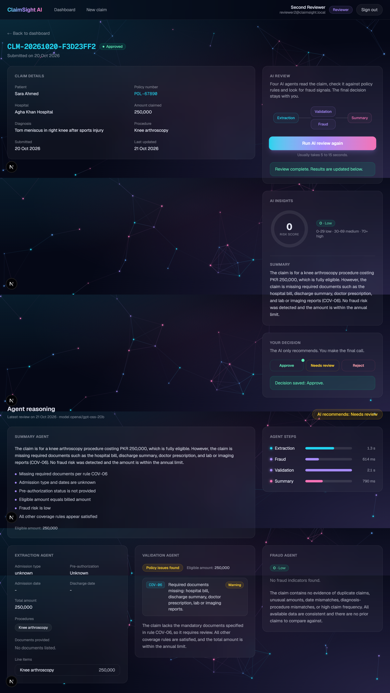
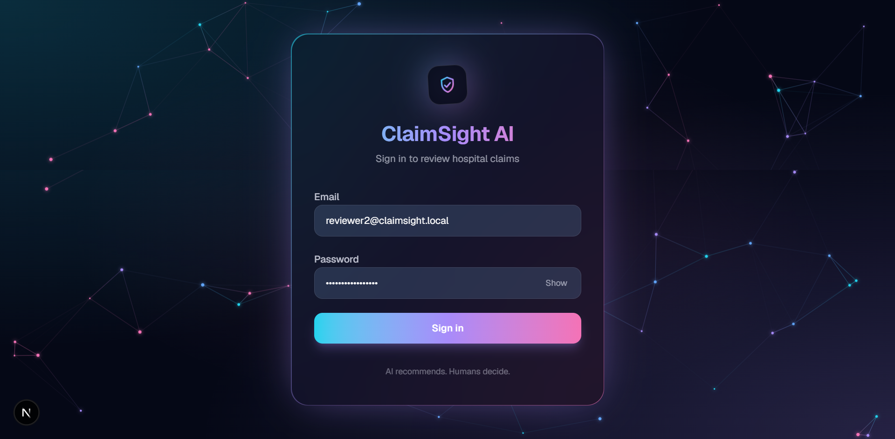
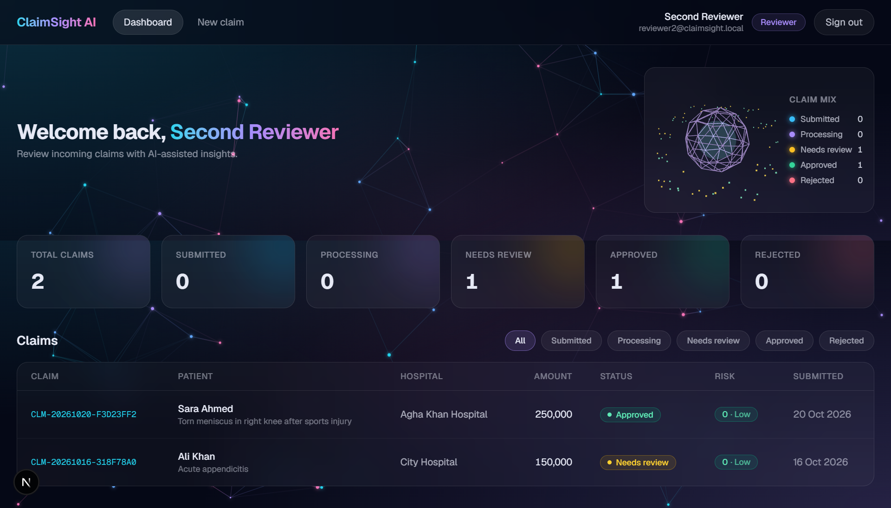
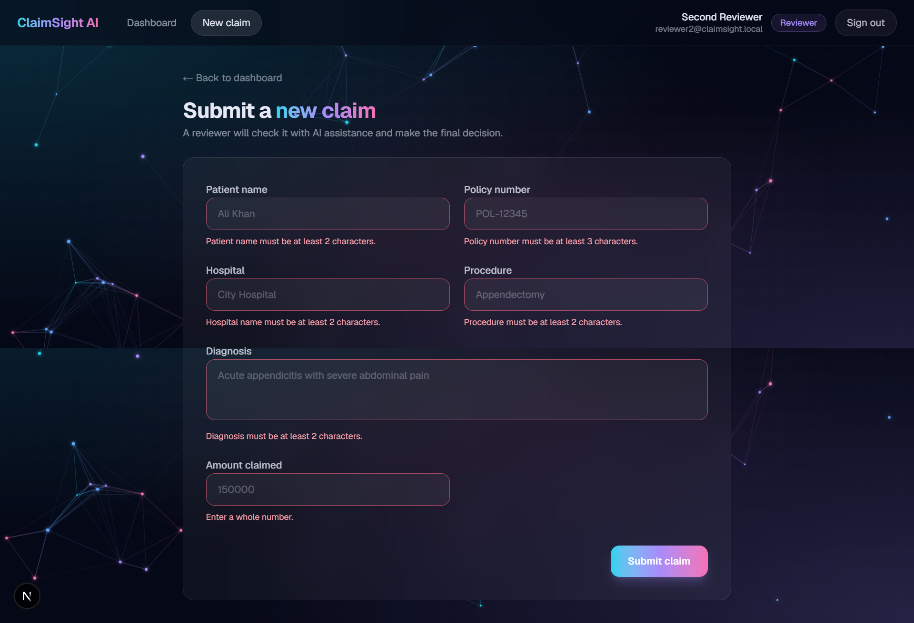
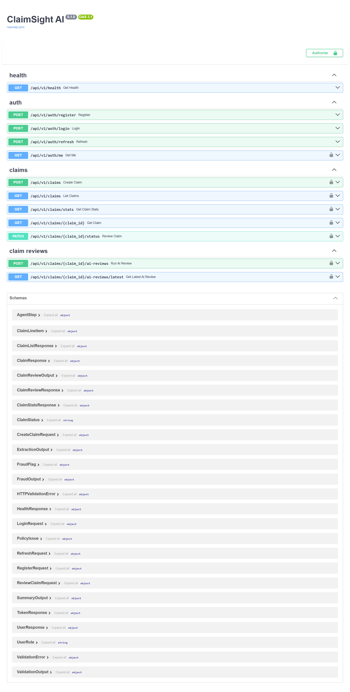
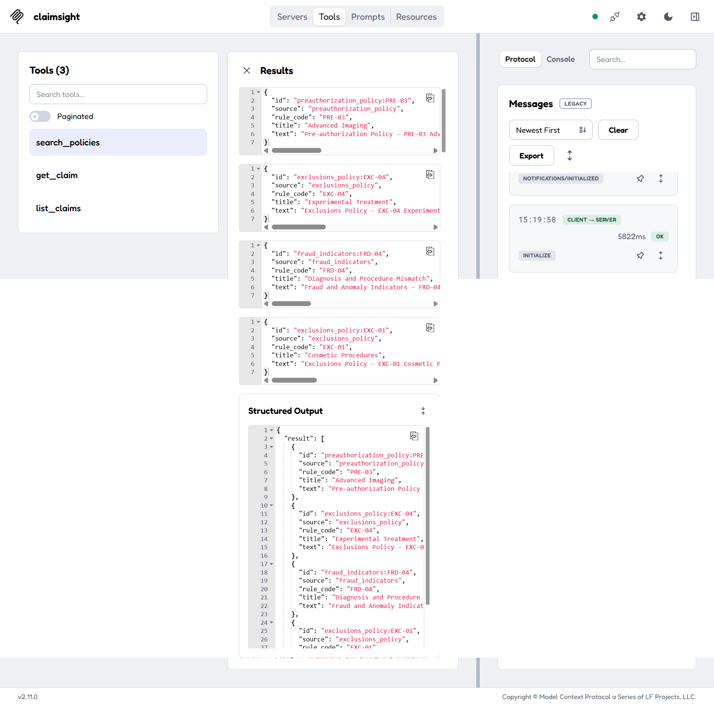
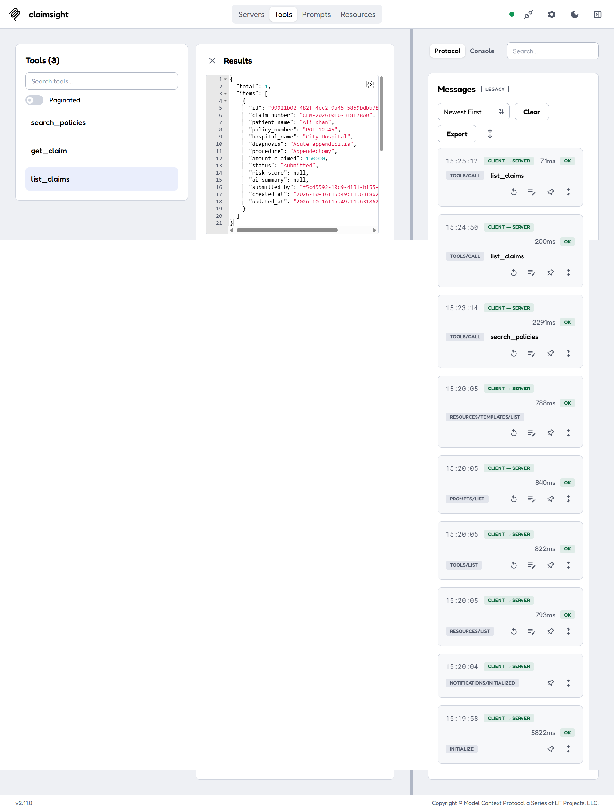
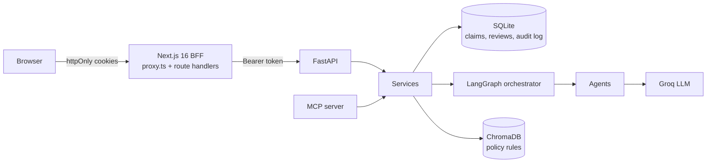
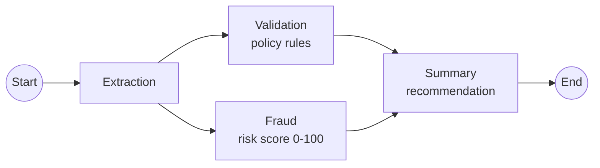

# ClaimSight AI

**AI-assisted hospital insurance claim review.** Hospitals and patients submit claims; a team of AI agents reads each claim, checks it against policy rules (RAG), flags fraud signals and writes a summary with a risk score. **The final approve / reject decision always stays with a human reviewer.**

> AI recommends. Humans decide.



## Features

- **Multi-agent review (LangGraph):** Extraction → Validation and Fraud in parallel → Summary, with per-agent timings.
- **Policy RAG:** 20 insurance rules (coverage, exclusions, pre-authorization, fraud indicators) in ChromaDB with local embeddings.
- **Hallucination guards:** unknown rule codes are dropped, duplicate claims are detected in code, and an approval is downgraded to "needs review" when a critical issue or non-low risk exists.
- **Human-in-the-loop:** reviewers approve, reject or send back a claim with a note; every action is written to an audit log.
- **Role-based access:** submitters only see their own claims (others return 404) and never see AI scores; reviewers cannot review their own claims.
- **MCP server:** read-only tools (`search_policies`, `get_claim`, `list_claims`, `get_claim_review`) for AI assistants.
- **Modern UI:** Next.js 16 with an animated particle network, motion animations, a 3D "claim mix" orb (React Three Fiber) and an agent reasoning view.
- **Secure by design:** tokens live only in httpOnly cookies behind a Next.js BFF; the browser never sees a token.

## Screenshots

| Login | Dashboard |
|---|---|
|  |  |

| New claim (validation) | API docs |
|---|---|
|  |  |

| MCP: search policies | MCP: list claims |
|---|---|
|  |  |

## Architecture



### Agent graph



### Backend layers

```
main.py -> middlewares -> routers -> services -> orchestrators -> agents -> clients
                                        |
                                   repositories -> db
mcp_servers -> services
```

Agents never touch the database or call each other; the orchestrator connects them and services own all data access.

## Tech stack

| Area | Tools |
|---|---|
| Backend | Python 3.12, FastAPI, SQLAlchemy (async, SQLite), Pydantic v2 |
| AI | LangGraph, Groq (`openai/gpt-oss-20b`), optional Gemini |
| RAG | ChromaDB with local ONNX embeddings (`all-MiniLM-L6-v2`, no API key) |
| Integrations | MCP server (`mcp` SDK) |
| Frontend | Next.js 16 (App Router), React 19, TypeScript, Tailwind CSS 4, motion, React Three Fiber |
| Quality | pytest (127 tests), ruff, mypy `--strict`, ESLint, pre-commit |

## Getting started

### Prerequisites

- Python 3.11+ (developed on 3.12)
- Node.js 20.9+ (developed on Node 24)
- A free [Groq](https://console.groq.com) API key

### 1. Backend

```bash
git clone https://github.com/engineer-husnain21/claimsight-ai.git
cd claimsight-ai

python -m venv .venv
# Windows: .venv\Scripts\activate
# macOS/Linux: source .venv/bin/activate

pip install -e ".[dev]"
cp .env.example .env    # Windows: copy .env.example .env
```

Edit `.env` and set at least `JWT_SECRET_KEY` (32+ random characters) and `GROQ_API_KEY`.

```bash
# Load the 20 policy rules into ChromaDB (first run downloads the embedding model)
python -m scripts.ingest_policies

# Create a reviewer (the script asks for a 12+ character password with a letter and a digit)
python -m scripts.create_user --email reviewer@example.com --full-name "Reviewer" --role reviewer

# Start the API (docs at http://127.0.0.1:8000/docs in development)
uvicorn app.main:app --reload
```

New users who sign up through `POST /auth/register` always get the `submitter` role.

### 2. Frontend

```bash
cd web
npm install
cp .env.example .env.local    # Windows: copy .env.example .env.local
npm run dev
```

Open http://localhost:3000 and sign in.

### 3. MCP server (optional)

Set `MCP_USER_EMAIL` in `.env` to an existing reviewer, then:

```bash
python -m app.mcp_servers.claims_mcp_server
# or inspect it:
npx @modelcontextprotocol/inspector .venv/Scripts/python.exe -m app.mcp_servers.claims_mcp_server
```

## Running checks

```bash
# Backend
ruff check app tests scripts
mypy app
pytest -q

# Frontend
cd web
npm run lint
npx tsc --noEmit
npm run build
```

## API overview

All routes are under `/api/v1`.

| Method | Path | Who | Purpose |
|---|---|---|---|
| GET | `/health` | Everyone | Health check |
| POST | `/auth/register` | Everyone | Sign up (always `submitter`) |
| POST | `/auth/login` | Everyone | Access + refresh tokens |
| POST | `/auth/refresh` | Everyone | New tokens from a refresh token |
| GET | `/auth/me` | Signed in | Current user |
| POST | `/claims` | Signed in | Submit a claim |
| GET | `/claims` | Signed in | List claims (filters: `status`, `limit`, `offset`) |
| GET | `/claims/stats` | Signed in | Claim counts per status (one grouped query) |
| GET | `/claims/{id}` | Signed in | Claim detail (submitters: own claims only) |
| PATCH | `/claims/{id}/status` | Reviewer, admin | Approve / reject / needs review, with a note |
| POST | `/claims/{id}/ai-reviews` | Reviewer, admin | Run the multi-agent AI review |
| GET | `/claims/{id}/ai-reviews/latest` | Reviewer, admin | Latest AI review |

## Security

**Backend**
- Argon2 password hashing; short-lived JWT access tokens (15 min) and refresh tokens (7 days).
- Role checks in services; reviewers cannot act on their own claims.
- Missing and forbidden claims both return 404, so claim ids cannot be probed.
- Rate limiting (general and a stricter auth limit), security headers, request IDs, and validation errors that never echo input values.
- Prompt-injection guard: claim text is wrapped in tags and the model is told to ignore instructions inside it.
- Audit log for claim creation, reviews and AI reviews. MCP tools are read-only.

**Frontend (BFF)**
- Tokens are stored only in httpOnly, SameSite=Lax cookies (Secure in production) set by the Next.js server; browser JavaScript never receives them.
- All backend calls go through server-only code (`import "server-only"`); the backend URL is never exposed to the browser.
- Origin check on every state-changing route handler (CSRF layer on top of SameSite).
- `proxy.ts` protects pages and silently refreshes expired access tokens.
- Open-redirect protection on the login `next` parameter.
- Content Security Policy, `X-Frame-Options: DENY`, `nosniff`, Referrer-Policy, Permissions-Policy and HSTS.

No system is 100% secure; see the limitations below.

## Known limitations

- **Rate limiting is per IP.** Behind the BFF every request reaches the backend from the Next.js server, so all users share one bucket. The dashboard now makes only 3 backend calls, but the planned fix is to rate-limit by user id.
- Refresh tokens are not revoked on logout, and the rate limiter is in memory (single process).
- The claim form has no documents, admission dates or bill line items, so every claim gets a COV-06 "missing documents" warning and the date-based duplicate check rarely runs. Planned: document upload.
- The database session stays open during an AI review (about 3-15 seconds); fine for SQLite and a single user.
- `gpt-oss-20b` is a small model; set `LLM_MODEL=openai/gpt-oss-120b` for stronger reasoning.
- The CSP allows `'unsafe-inline'` because Next.js and the animation library inject inline code; nonce-based CSP is a future improvement.
- `npm audit` reports a `braces` issue inside the ESLint tooling (development only, not shipped to users).
- The audit log does not yet record client IP addresses.

## Project structure

```
claimsight-ai/
├── app/                 # FastAPI backend
│   ├── agents/          # Extraction, Validation, Fraud, Summary agents
│   ├── clients/         # LLM clients (Groq, Gemini)
│   ├── core/            # Config, exceptions, logging, dependencies, prompt loader
│   ├── mcp_servers/     # Read-only MCP server
│   ├── middlewares/     # Request ID, logging, errors, rate limit, security headers
│   ├── models/          # SQLAlchemy models
│   ├── orchestrators/   # LangGraph claim review graph
│   ├── prompts/         # Agent system and user prompts
│   ├── repositories/    # Data access (SQLite, ChromaDB)
│   ├── routers/         # API routes
│   ├── schemas/         # Pydantic request/response models
│   └── services/        # Business rules
├── data/policies/       # Insurance policy rules (RAG source)
├── scripts/             # create_user, ingest_policies
├── tests/               # Unit and integration tests (127)
├── web/                 # Next.js frontend (BFF, UI)
└── docs/screenshots/
```

## License

Personal portfolio project.